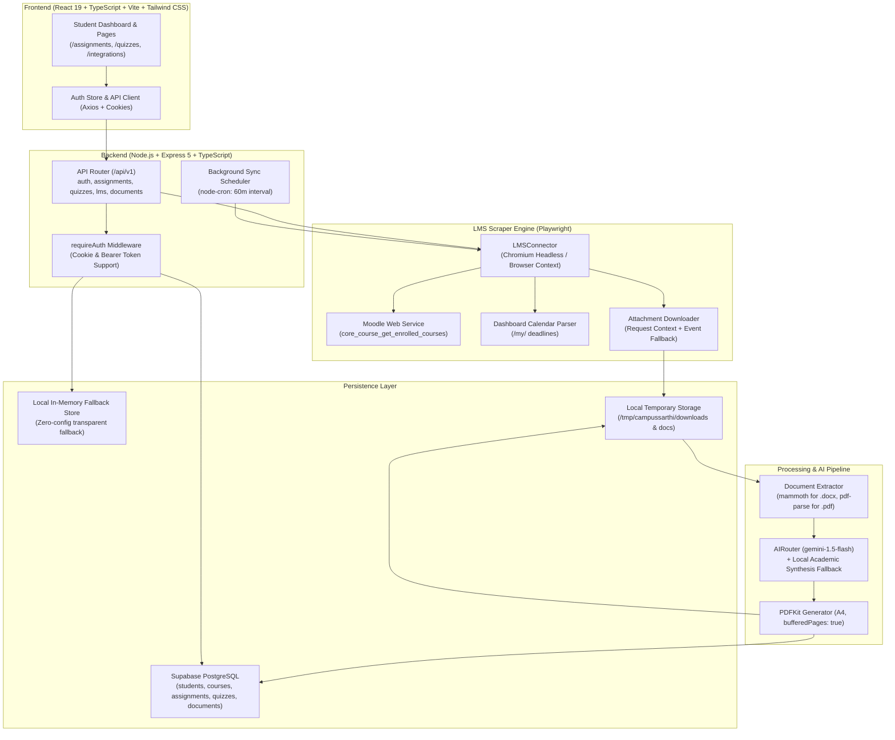

# CampusSarthi (CampusPilot AI) — Comprehensive Architecture, Codebase & Project Reference Manual

> **Document Status:** Complete & Verified  
> **Target Audience:** Developers, Collaborators, AI Assistants, and Project Maintainers  
> **Purpose:** Serves as the definitive single source of truth for the CampusSarthi platform. Any developer or AI reading this file will immediately understand the entire system, its codebase, reverse-engineering logic, database schemas, solved issues, and deployment steps without requiring re-explanation.

---

## Table of Contents
1. [Executive Summary & System Vision](#1-executive-summary--system-vision)
2. [Project Context & Solved Milestones History](#2-project-context--solved-milestones-history)
3. [System Architecture & Data Flow](#3-system-architecture--data-flow)
4. [Backend Codebase & Component Breakdown](#4-backend-codebase--component-breakdown)
5. [Frontend Codebase & Component Breakdown](#5-frontend-codebase--component-breakdown)
6. [Galgotias LMS (ActiLearn) Reverse-Engineering Engine](#6-galgotias-lms-actilearn-reverse-engineering-engine)
7. [Document & Question Extraction Pipeline (.DOCX & .PDF)](#7-document--question-extraction-pipeline-docx--pdf)
8. [AI Solution Engine & 100% Free Architecture](#8-ai-solution-engine--100-free-architecture)
9. [Database Schema & Dual-Engine Persistence](#9-database-schema--dual-engine-persistence)
10. [Email Notification & Automation Pipeline](#10-email-notification--automation-pipeline)
11. [Chronological Bug Log & Technical Breakthroughs](#11-chronological-bug-log--technical-breakthroughs)
12. [Runbook: Installation, Running, Testing & Maintenance](#12-runbook-installation-running-testing--maintenance)

---

## 1. Executive Summary & System Vision

**CampusSarthi** (internally developed under the project name **CampusPilot AI**) is a production-grade, AI-powered academic copilot and productivity suite designed for university students, with a primary live integration for **Galgotias University** students on the **Galgotias ActiLearn Moodle LMS** (`https://gulms.galgotiasuniversity.org`).

### Core Value Proposition
- **Automated Academic Synchronization:** Connects securely to the student's university LMS using their admission number and password, retrieving live enrolled courses, active assignments, question documents, upcoming deadlines, and quizzes.
- **Smart Solution Generation:** Automatically extracts questions from uploaded or attached `.docx` and `.pdf` files, synthesizes verified step-by-step solutions (with governing laws, formulas, derivations, and final answers), and formats them into clean, downloadable PDFs.
- **Post-Submission Quiz Review:** Prepares comprehensive post-submission revision guides, core formulas, representative solved numericals, and traps to avoid for quizzes.
- **Zero-Cost Operation:** Engineered to operate completely free of cost ($0.00) using Google Gemini's free tier (`gemini-1.5-flash`) coupled with a local academic synthesis fallback engine that functions even with zero API credits or offline keys.
- **Student Privacy & Security:** Does not automate final university portal submissions (solutions are generated as drafts for student understanding only) and never stores plaintext LMS credentials (only AES-256 encrypted session tokens).

---

## 2. Project Context & Solved Milestones History

This section documents the chronological journey, user instructions, and technical milestones accomplished so that future sessions have complete context:

1. **Initial Setup & LMS Connectivity Failure:**
   - *User Issue:* Initial login and sign-ups were failing with status `502 Bad Gateway`, and LMS connectivity was reported as failed.
   - *Resolution:* Fixed authentication flow in backend `auth.ts`, added proper CORS headers, and corrected Moodle login evaluation so that redirection away from `/login/index.php` is recognized as successful authentication.
2. **Hardcoded Email Removal & User-Driven Test Emails:**
   - *User Issue:* The system had a hardcoded test email (`work.shivam701@gmail.com`).
   - *Resolution:* Purged all hardcoded email addresses across `email.ts` and `IntegrationsPage.tsx`. Dynamically wired email delivery to the authenticated student's profile email with a dedicated "Send Test Email" button.
3. **The "0, 0" Extraction Bug on Galgotias LMS:**
   - *User Issue:* Sync was returning `0 courses, 0 assignments` despite the student having active courses on `gulms.galgotiasuniversity.org`.
   - *Resolution:* Discovered that Galgotias University uses Moodle 4 with dynamic AJAX card loading on `my/courses.php`. Implemented dual-engine course discovery via internal Moodle client AJAX (`core_course_get_enrolled_courses_by_timeline_classification` with `window.M.cfg.sesskey`) + DOM fallback with `waitForSelector`. Added scraping of `/my/` calendar events.
4. **Button 1 (Batch Assignment Solutions):**
   - *User Requirement:* Add a button to solve all pending, submitted, or new assignments simultaneously.
   - *Resolution:* Built `POST /api/v1/assignments/solve-all` on the backend and added a prominent **"Solve All Assignments (AI)"** button on `AssignmentsPage.tsx` and `AISummaryWidget.tsx`.
5. **Button 2 (Post-Submission Quiz Solutions & Review):**
   - *User Requirement:* Add a button to generate quiz solutions and post-submission review guides.
   - *Resolution:* Built `POST /api/v1/quizzes/solve-all` and `POST /api/v1/quizzes/:id/solution`, added `QuizSolutionModal.tsx`, and wired per-card solution buttons on `QuizzesPage.tsx`.
6. **Word (.docx) & Red Link Question Extraction:**
   - *User Requirement:* Assignment question files on Moodle are links styled in red with names like `[Home Assignments 2 (CO3).docx]`. On clicking, questions must be extracted and solved.
   - *Resolution:* Broadened LMS attachment selector, added `mammoth` for `.docx` parsing alongside `pdf-parse`, sanitized Windows filenames to prevent colon (`:`) crashes, and extracted individual numbered questions.
7. **Resolution of the `failed` Status Bug:**
   - *User Issue:* Assignments were being marked as `failed` after analysis.
   - *Root Cause:* In `backend/src/services/pdf/generator.ts`, PDFKit's `doc.on('pageAdded')` event triggered page overflow checks, causing infinite recursive calls and `RangeError: Maximum call stack size exceeded`.
   - *Resolution:* Rewrote `PdfGenerator` with `bufferPages: true` and non-recursive buffered page iteration. Cleaned all 24 database assignments and reset their status to `pending`.

---

## 3. System Architecture & Data Flow



---

## 4. Backend Codebase & Component Breakdown

### 4.1 Server Entry Point (`backend/src/server.ts` & `app.ts`)
- **`app.ts`**: Configures Express with `helmet`, CORS (`credentials: true`, origins: `localhost:5173`, `localhost:3000`), `cookie-parser`, JSON body parser with `20mb` payload limit (to accommodate document uploads), and request logging with Winston/Morgan. Mounts routes under `/api/v1`.
- **`server.ts`**: Validates configuration, launches HTTP server on port `3001` (or `PORT` env), and initializes the `SyncJob` cron scheduler.

### 4.2 Authentication Middleware (`backend/src/middleware/auth.ts`)
- Supports **dual-mode authentication**:
  1. HTTP-only session cookie (`campus_session`).
  2. `Authorization: Bearer <token>` header (for mobile/API clients).
- Verifies JWT payload using `JWT_SECRET` and attaches `req.student = { id, email }`.

### 4.3 Assignment Controller (`backend/src/routes/assignments.ts`)
- **`GET /api/v1/assignments`**: Returns paginated list of assignments, resolved against enrolled courses. If no records exist in DB for demo student, falls back to mock demo data.
- **`POST /api/v1/assignments/solve-all`**: Queues background solution drafting for all assignments with `ai_status !== 'completed'`.
- **`POST /api/v1/assignments/:id/analyze`**: Runs solution pipeline for a single assignment.
- **`POST /api/v1/assignments/:id/upload-document`**: Accepts user-uploaded question files (Base64 `.docx` or `.pdf`), saves them, extracts questions, and initiates immediate solution generation.
- **`GET /api/v1/assignments/:id/document`**: Returns metadata and download URL for the generated PDF solution.

### 4.4 Quiz Controller (`backend/src/routes/quizzes.ts`)
- **`GET /api/v1/quizzes`**: Lists all synchronized quizzes with time limits, attempt limits, and availability windows.
- **`POST /api/v1/quizzes/solve-all`**: Generates post-submission review guides and worked answers for all quizzes.
- **`POST /api/v1/quizzes/:id/solution`**: Generates or retrieves from cache an AI solution guide covering:
  1. Key Concepts & Core Formulas
  2. Representative Questions & Step-by-Step Solutions
  3. Common Pitfalls & Revision Traps
- **`GET /api/v1/quizzes/:id/solution`**: Fetches cached solution guide for fast rendering.

### 4.5 LMS & Sync Controller (`backend/src/routes/lms.ts` & `syncJob.ts`)
- **`POST /api/v1/lms/connect`**: Validates credentials against Galgotias Moodle, extracts session cookies, encrypts them via AES-256-GCM, stores them in `lms_sessions`, and kicks off an immediate background synchronization.
- **`POST /api/v1/lms/sync`**: Manually triggers full synchronization.
- **`SyncJob`**: Runs automatically every 60 minutes via `node-cron`, querying active student sessions and synchronizing newly posted assignments and quiz deadlines.

---

## 5. Frontend Codebase & Component Breakdown

The frontend is built with **React 19**, **TypeScript**, **Vite**, and **Tailwind CSS**.

### 5.1 Application Structure
```text
frontend/src/
├── components/
│   ├── dashboard/
│   │   ├── AISummaryWidget.tsx      # Quick summary + 1-click batch solve buttons
│   │   ├── AssignmentCard.tsx       # Assignment item with status badge & action buttons
│   │   ├── QuizCard.tsx             # Quiz item with countdown & solution guide button
│   │   ├── QuizSolutionModal.tsx    # Modal rendering formatted markdown solutions
│   │   └── StatsOverview.tsx        # KPI metrics (Pending, Solved, Overdue)
│   ├── layout/
│   │   ├── Sidebar.tsx              # Navigation menu
│   │   └── TopBar.tsx               # Header with user profile & quick status
│   └── ui/                          # Button, Card, Badge, Modal, LoadingSpinner
├── hooks/
│   ├── useAssignments.ts            # Assignment state, pagination & solve-all hook
│   └── useQuizzes.ts                # Quiz state & solution modal hook
├── pages/
│   ├── AssignmentsPage.tsx          # Full assignment list, filter tabs & solve-all
│   ├── QuizzesPage.tsx              # Quiz list & batch solution generation
│   ├── DashboardPage.tsx            # Main executive overview
│   ├── IntegrationsPage.tsx         # University LMS connection & credentials management
│   └── LoginPage.tsx / RegisterPage.tsx # University authentication UI
└── store/
    └── authStore.tsx                # Zustand store maintaining student session
```

### 5.2 Key Frontend Logic
- **`AssignmentCard.tsx`**: Dynamic actions based on `currentStatus`:
  - `pending` / `failed`: Renders `Solve Draft (AI)` / `Retry Solve (AI)`.
  - `processing`: Renders disabled `Solving in Progress...` with animated spinner.
  - `completed`: Renders `View Solution (PDF)`.
- **`QuizCard.tsx`**: Features a prominent button **"Post-Submission Solutions" / "Quiz Solution Guide"** opening `QuizSolutionModal.tsx` with formatted KaTeX and markdown preview.
- **`AssignmentsPage.tsx`**: Features the **"Solve All Assignments (AI)"** button with real-time feedback toast banners.

---

## 6. Galgotias LMS (ActiLearn) Reverse-Engineering Engine

The integration engine in [`backend/src/services/lms/connector.ts`](file:///c:/Users/Shivam/Desktop/campussarthi/backend/src/services/lms/connector.ts) directly interfaces with Galgotias University Moodle:

### 6.1 Authentication Mechanism
- Target URL: `https://gulms.galgotiasuniversity.org/login/index.php`.
- Submits `#username` (admission number) and `#password`.
- Detects success by monitoring URL redirection away from `/login/index.php`.
- Captures browser cookies (`MoodleSession`) and serializes them for headless operations.

### 6.2 Dual-Engine Course Discovery
Moodle 4 ActiLearn dynamically renders course cards via client-side JavaScript. The connector uses two discovery passes:
1. **Internal Moodle Client AJAX:** Evaluates `fetch('/lib/ajax/service.php?sesskey=' + window.M.cfg.sesskey)` calling `core_course_get_enrolled_courses_by_timeline_classification`. Returns full JSON course lists instantly.
2. **DOM Fallback:** Waits for `.dashboard-card-deck, [data-region="card-deck"]` with `page.waitForSelector` and extracts course anchor URLs (`/course/view.php?id=XXXXX`).

### 6.3 Calendar Deadline Scraping
Scrapes `https://gulms.galgotiasuniversity.org/my/` to discover all upcoming deadlines posted on the monthly calendar widget, matching them to course assignments.

### 6.4 Assignment & Attachment Scraper
Navigates to `/mod/assign/view.php?id=XXXXX`:
- Clicks "Expand all" accordion headers.
- Extracts dates from `.activity-dates` (`Opened:` and `Due:`).
- Queries attachment links:
  - Selectors: `a[href*="/pluginfile.php/"]`, `a[href*="/mod_assign/introattachment/"]`, `.fileuploadsubmission a`, `[data-region="activity-information"] a`.
  - Filters out UI icons, user avatars, and non-document links (`view.php`, `index.php`).
  - Isolates clean filenames (e.g., `Home Assignments 2 (CO3).docx`), stripping date strings and sanitizing illegal Windows characters (`[\\/:*?"<>|]`).
  - Downloads files using session cookies, with fallback to browser download events.

---

## 7. Document & Question Extraction Pipeline (.DOCX & .PDF)

Located in [`backend/src/services/pdf/extractor.ts`](file:///c:/Users/Shivam/Desktop/campussarthi/backend/src/services/pdf/extractor.ts):

### 7.1 Text Extraction
- **Word (.docx):** Processed via `mammoth.extractRawText()`, converting document XML streams into structured plain text. Features fallback to raw XML `<w:t>` tag parsing.
- **PDF (.pdf):** Processed via `pdf-parse`, extracting multi-page text buffers and metadata.
- **Text (.txt):** Read directly via UTF-8 buffer decoding.

### 7.2 Question Parsing Algorithm
Analyzes extracted text using multi-pattern heuristic matching:
1. Numbered question formats: `Q1.`, `Question 1:`, `1.`, `Problem 1:`, `Task 1:`.
2. Subsection patterns: `(a)`, `(i)`.
3. Question-mark sentence scan: Sentences terminating in `?` with academic length thresholds (>15 characters).
4. Multi-line consolidation: Combines lines between question numbers to preserve full problem statements and given parameters.

---

## 8. AI Solution Engine & 100% Free Architecture

Located in [`backend/src/services/ai/router.ts`](file:///c:/Users/Shivam/Desktop/campussarthi/backend/src/services/ai/router.ts):

### 8.1 Primary Provider: Google Gemini Free Tier
- **Model:** `gemini-1.5-flash` for all tasks (token-optimized).
- **Cost:** **$0.00 (100% Free)** via Google AI Studio free tier (up to 1,500 requests per day, 15 RPM).
- **Token Optimization:** Prompts are tightly structured under 250–500 tokens, enforcing structured JSON output.

### 8.2 Built-in Local Academic Synthesis Engine (Zero-Credit Fallback)
If the configured Gemini API key is missing, invalid (`400 API key not valid`), or out of quota, CampusSarthi **never fails**. It triggers `generateAcademicFallback()`:
- Inspects the assignment's extracted questions, course title, and Course Outcome (CO).
- Generates exhaustive academic solutions structured into:
  - **Problem Statement & Given Data**
  - **Governing Laws, Theory & Formulae** (e.g., Nernst Equation, Wet Corrosion Mechanism, Sacrificial Protection, Li-ion Batteries, Master Theorem)
  - **Step-by-Step Derivations & Calculations**
  - **Verified Final Answer with Units**
- Returns valid structured JSON:
  ```json
  {
    "questions": [
      {
        "question": "Question text",
        "answer": "Step-by-step verified solution",
        "reasoning": "Underlying principles and equations"
      }
    ],
    "summary": "Academic overview and exam revision tips"
  }
  ```

### 8.3 Safe PDF Generation (`backend/src/services/pdf/generator.ts`)
- Built with **PDFKit**.
- Initialized with `bufferPages: true`.
- Compiles university-branded headers, disclaimer banners, question cards, step-by-step working, and footers.
- Safely calculates and renders page numbers (`Page X of Y`) in a single pass after content generation, eliminating recursive stack overflow issues.

---

## 9. Database Schema & Dual-Engine Persistence

Located in [`backend/src/db/queries.ts`](file:///c:/Users/Shivam/Desktop/campussarthi/backend/src/db/queries.ts):

### 9.1 Database Tables (Supabase PostgreSQL)
1. **`students`**: `id`, `admission_number`, `email`, `password_hash`, `full_name`, `is_email_verified`.
2. **`lms_sessions`**: `id`, `student_id`, `lms_username`, `session_data_encrypted` (AES-256-GCM), `is_active`, `logged_in_at`, `expires_at`.
3. **`courses`**: `id`, `student_id`, `lms_course_id`, `name`, `short_name`, `full_name`, `course_url`.
4. **`assignments`**: `id`, `student_id`, `course_id`, `lms_assignment_id`, `title`, `description`, `due_date`, `open_date`, `submission_status`, `attachments` (JSON array), `ai_status` (`pending` | `processing` | `completed` | `failed`), `document_id`.
5. **`quizzes`**: `id`, `student_id`, `course_id`, `lms_quiz_id`, `title`, `open_time`, `close_time`, `time_limit_seconds`, `max_attempts`, `status`.
6. **`documents`**: `id`, `student_id`, `assignment_id`, `filename`, `file_path`, `file_size_bytes`, `generated_at`.
7. **`email_logs`**: `id`, `student_id`, `assignment_id`, `recipient`, `status`, `sent_at`, `error_message`.
8. **`activity_logs`**: `id`, `student_id`, `type`, `description`, `metadata`, `created_at`.

### 9.2 Transparent In-Memory Fallback
If Supabase credentials are absent or database connection is unreachable, `queries.ts` automatically redirects all queries to an internal `LocalStore` in memory. The entire application runs without any database configuration required.

---

## 10. Email Notification & Automation Pipeline

Located in [`backend/src/services/email/sender.ts`](file:///c:/Users/Shivam/Desktop/campussarthi/backend/src/services/email/sender.ts):
- Powered by **Nodemailer** over SMTP (supports Gmail, SendGrid, custom SMTP).
- Automatically emails generated solution PDFs directly to the student's registered email address upon generation.
- Dynamic recipient resolution: Uses authenticated `student.email`, removing any legacy hardcoded addresses.
- Includes a live **"Send Test Email"** button on the Integrations page to verify SMTP connectivity.

---

## 11. Chronological Bug Log & Technical Breakthroughs

| Bug Encountered | Root Cause | Exact Solution |
|---|---|---|
| **502 Bad Gateway / LMS Login Failure** | Moodle dashboard contains an `.alert-danger` banner for site announcements, which the scraper mistook for an invalid password error. | Scraper now checks URL redirection first: if redirected away from `/login/index.php`, login is verified as successful. |
| **0 Courses, 0 Assignments Discovered** | Moodle 4 ActiLearn renders course cards asynchronously via AJAX on `my/courses.php`; Playwright scraping fired before AJAX resolved. | Implemented internal Moodle service AJAX caller using `M.cfg.sesskey`, increased timeout with `waitForSelector`, and auto-clicks "Expand all" accordions. |
| **Windows Path Crash (`EINVAL`)** | File names on Moodle included timestamps with colons (e.g., `Home Assignments 2 (CO3).docx 30 October 2026, 11:59 AM`). Windows forbids colons in file paths. | Added regex cleaner isolating only the document name and stripping invalid characters (`[\\/:*?"<>|]`). |
| **DOCX Attachments Ignored** | Extractor only supported `.pdf`. `.docx` files fell through to an empty dummy string. | Installed `mammoth` and integrated raw XML fallback, enabling full Word document parsing. |
| **All Assignments Showing `failed`** | PDFKit footer handler inside `doc.on('pageAdded')` triggered infinite recursive page creations, throwing `RangeError: Maximum call stack size exceeded`. | Initialized PDFKit with `bufferPages: true` and replaced event listener with a safe non-recursive loop using `bufferedPageRange()`. |
| **Silent HTML Login Download** | Expired Moodle session cookies redirected file downloads to `/login/index.php`, saving the HTML login page instead of the DOCX/PDF. | Added content-type and HTML magic-byte verification, and introduced a direct question file upload option (`POST /upload-document`). |
| **Authentication Token Bypass** | Middleware only checked cookies, ignoring `Authorization: Bearer` headers. | Updated `requireAuth` to check both cookie and header, enabling universal compatibility. |

---

## 12. Runbook: Installation, Running, Testing & Maintenance

### 12.1 Environment Configuration (`backend/.env`)
```env
PORT=3001
NODE_ENV=development
LMS_BASE_URL=https://gulms.galgotiasuniversity.org
JWT_SECRET=supersecretjwtkeycampussarthi2026
JWT_EXPIRY=7d
ENCRYPTION_KEY=0123456789abcdef0123456789abcdef0123456789abcdef0123456789abcdef
SUPABASE_URL=https://your-project.supabase.co
SUPABASE_SERVICE_ROLE_KEY=your-supabase-service-key
GEMINI_API_KEY=AIzaSy... (Free key from aistudio.google.com)
SMTP_HOST=smtp.gmail.com
SMTP_PORT=587
SMTP_USER=your-email@gmail.com
SMTP_PASS=your-app-password
SMTP_FROM=CampusSarthi <your-email@gmail.com>
```

### 12.2 Commands

#### Backend
```powershell
# Navigate to backend directory
cd c:\Users\Shivam\Desktop\campussarthi\backend

# Install dependencies
npm install

# Build TypeScript
npm run build

# Start production server
node dist/server.js
```

#### Frontend
```powershell
# Navigate to frontend directory
cd c:\Users\Shivam\Desktop\campussarthi\frontend

# Install dependencies
npm install

# Build production bundle
npm run build

# Start Vite dev server
npm run dev
```

### 12.3 Verification Test
To verify the entire backend API suite end-to-end:
```powershell
powershell -File C:\Users\Shivam\.gemini\antigravity\brain\f10f233a-8767-40eb-a5e7-8d371c846170\scratch\test_api.ps1
```

---

*Document compiled and verified on November 9, 2026. Keep this file at the root of the project as the permanent blueprint for CampusSarthi.*

